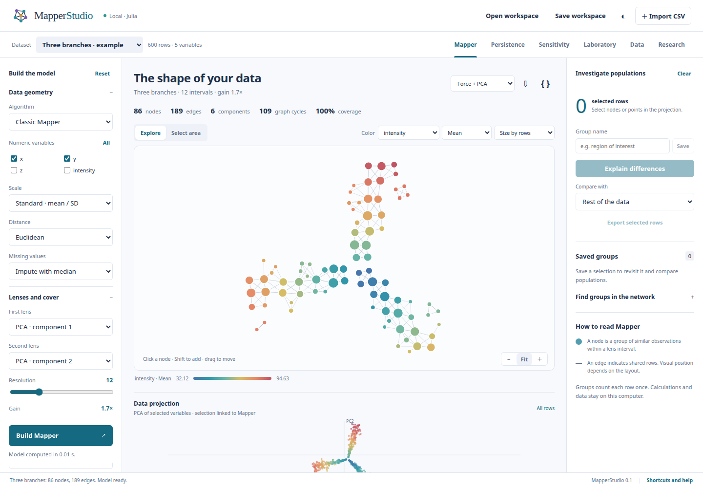

# MapperStudio.jl

[](https://github.com/JuliaTDA/MapperStudio.jl/actions/workflows/CI.yml)

A local Mapper and TDA workbench with a Julia scientific backend and a browser
interface in English. It reconstructs the main Ayasdi-style exploration
workflow using this ecosystem's implementations, with explicit scientific
limits and no dependency on an external service.



## Install and start

Install **Julia 1.12 or newer**. In Julia, press `]` to enter package mode:

```julia
pkg> app add https://github.com/JuliaTDA/MapperStudio.jl
```

Then run in your terminal:

```bash
mapperstudio
```

Open **[http://localhost:8090](http://localhost:8090)**. Ctrl+C stops the server.
Use `mapperstudio --port 8091` (or `MAPPER_STUDIO_PORT=8091`),
`mapperstudio --help`, and `mapperstudio --version` as needed.

If your terminal cannot find the command, add Julia's app directory to `PATH`.
For bash/zsh on Linux or macOS, add this line to your shell configuration and
open a new terminal:

```bash
export PATH="$HOME/.julia/bin:$PATH"
```

On Windows, add `%USERPROFILE%\.julia\bin` to your user `Path` and open a new
terminal. You can also run `~/.julia/bin/mapperstudio` directly on Linux/macOS,
or `%USERPROFILE%\.julia\bin\mapperstudio.bat` in Windows Command Prompt.
With a custom `JULIA_DEPOT_PATH`, use the `bin` directory of the first depot.

The same installation can be performed directly from the terminal:

```bash
julia --startup-file=no -e 'using Pkg; Pkg.Apps.add(url="https://github.com/JuliaTDA/MapperStudio.jl")'
```

No sibling checkouts or custom registry are required. Installation downloads
the Julia dependencies; all browser assets and examples are bundled. After
setup, no CDN, font service or online calculation is needed. The first analysis
includes Julia's compilation time.

Julia's [Pkg Apps](https://pkgdocs.julialang.org/v1/apps/) support is currently
experimental. This installs a launcher backed by Julia, so Julia must remain
installed. If you remove the Julia version used to install the app, reinstall
the app with your current Julia.

In Julia package mode, reinstall from the URL to get the latest app, or remove it:

```julia
pkg> app add https://github.com/JuliaTDA/MapperStudio.jl
pkg> app rm MapperStudio
```

`app add MapperStudio` by name will require future registry publication; use
the repository URL for this release.

## Develop from a checkout

```bash
git clone https://github.com/JuliaTDA/MapperStudio.jl
cd MapperStudio.jl
julia --startup-file=no scripts/setup.jl
julia --startup-file=no --project=. --threads=auto -m MapperStudio
```

The `[sources]` entries pin the tested JuliaTDA dependencies to public Git
revisions. The MIT-licensed multiparameter reference implementation is bundled
under [`vendor/MultiparameterPersistence`](vendor/MultiparameterPersistence),
with its original license. The real example's provenance is in [`data`](data).
Generated Manifests are local and excluded from version control.

## Explore

1. Start with the three-branch example, a circle, a torus, three populations,
   or the bundled real diabetes dataset.
   Import your own CSV/TSV using **Import CSV**.
2. Choose numeric variables, scaling, distance, one or two lenses, resolution,
   gain, cover, clustering and an edge rule. **Build Mapper** applies the
   settings. Color/layout changes update the view without recomputation.
3. Click nodes, Shift-click to extend selection, or select an area. The linked
   PCA projection and original-data table use the same original row IDs. Drag
   nodes, pan, zoom or use keyboard Tab/Enter. Save selected rows as groups.
4. **Explain differences** compares a deduplicated population with the rest or
   another saved group. Histograms, KS/total-variation distances, effect sizes,
   permutation p-values and BH q-values are available for export.
5. Explore Rips H0/H1/H2, diagrams, barcodes, Betti curves and entropy in
   **Persistence**. **Sensitivity** compares cover parameters and saves
   model snapshots. **Laboratory** provides ToMATo, sliding-window PH,
   function-Rips Hilbert/Euler surfaces, and cubical image PH/Euler curves.
6. Save a workspace JSON to keep data, groups, selection, model configurations,
   positions and visual settings. Open it to reconstruct the model in Julia.
   SVG, graph/results JSON, row CSV and a self-contained Julia analysis script
   are also exportable. An imported workspace is data, never evaluated code.

The browser's data table shows original values. Median imputation and scaling
are applied to a separate geometry matrix, with a preprocessing audit. Numeric
values use Float64. Blank cells are missing, not zero. Categorical variables are
available for coloring, Explain and export; they are not silently encoded for
geometry.

## Scientific scope

- The graph's cycle rank `E−V+C` is labeled separately from persistence of the
  original point cloud. Layout and color do not affect memberships.
- Gain means overlap `1−1/gain` in the covered coordinate. Equalization covers
  tied mean ranks; ties can prevent equal population sizes. This differs from
  treating TDAmapper's `expansion` as an overlap percentage.
- PCA uses the geometry variables. Metric MDS uses up to 200 farthest-point
  landmarks and an out-of-sample projection. Diffusion uses a Gaussian affinity
  and symmetric normalization, and is limited to 600 rows. These are not claims
  of equivalence to Ayasdi's proprietary Neighborhood lenses.
- K-means uses a fixed RNG and Euclidean geometry. DBSCAN noise becomes
  singleton nodes, preventing a disconnected noise population from forming an
  artificial node. Ball Mapper uses a greedy epsilon net in the selected metric.
- Explain uses seeded permutation calibration, including ties. Minimum possible
  p is `1/(permutations+1)`. BH covers the tested feature family, not the bias of
  choosing a group after seeing the data. An overlapping reference loses the
  intersection so no observation appears in both samples.
- PH uses Vietoris–Rips and F₂ with the same selected metric/scaling. Original
  row IDs identify every landmark. Indistinguishable zero-distance observations
  are collapsed for PH and counted in the output. Essential or threshold-censored
  deaths serialize as JSON `null`, not fabricated finite values. Sampling may
  alter topology. Higher-order distances such as cosine/correlation are
  dissimilarities; general metric stability results need their own assumptions.
- Temporal embeddings use original series values, Euclidean distances, row
  order and index-based delays. Images explicitly downsample to at most 96×96,
  use unit pixel spacing and the vertex lower-star cubical convention. Image
  filtration values are translated to start at zero, with the offset exported.
- Function-Rips uses Euclidean geometry, finite F₂ calculations, at most 28
  landmarks and a 10×10 grid. Its Euler surface is that of the truncated complex.

Limits: 3,000 source rows, 80 geometry variables, 160 total columns, 20 MB per
request, 2,000 Mapper nodes, at most 300 Rips landmarks for H0/H1 or 80 for H2,
20 cover configurations and 25 temporal windows. The server queues one expensive
computation at a time. It retains eight tables and sixteen graph results; a
workspace file is the persistent backup. There is no million-row/distributed
backend, accounts, remote collaboration or guaranteed automatic model optimum.

See the [full Ayasdi research and feature matrix](docs/ayasdi-research.md),
[design/implementation plan](docs/implementation-plan.md),
[REST contract](docs/api.md), and [validation report](docs/validation.md).
The full research is also served at `/research`.

## Julia API

```julia
using MapperStudio

ds = parse_csv(read("data.csv", String); name="My data")
cfg = Dict("columns"=>["x", "y"], "resolution"=>12, "gain"=>1.7,
           "lens1"=>"pca1", "lens2"=>"pca2")
graph = analyze(ds, cfg)
rows = graph["nodes"][1]["members"]
# Requires at least two selected and two reference observations.
differences = explain(ds, rows; permutations=999, seed=2007)
ph = persistence_analysis(ds, cfg; sample=220, dimension=1)
```

## Verification

```bash
julia --startup-file=no --project=. --threads=4 -e 'using Pkg; Pkg.test()'
node --check web/app.js
```

Tests check analytic circle/annulus references, SciPy KS fixtures, overlap
geometry, memberships/nerve edges, all refiners and lenses, deterministic
clustering, duplicate distances, preprocessing, advanced workflows and REST
boundaries. Browser checks exercise real Julia calculations and downloaded
workspace/script round trips; their results are recorded in the validation guide.

Code is under the [MIT license](LICENSE). Historical Ayasdi sources
and upstream Julia packages retain their own attribution and licenses. The app
does not use Ayasdi code, logos, data, or proprietary implementation details.
